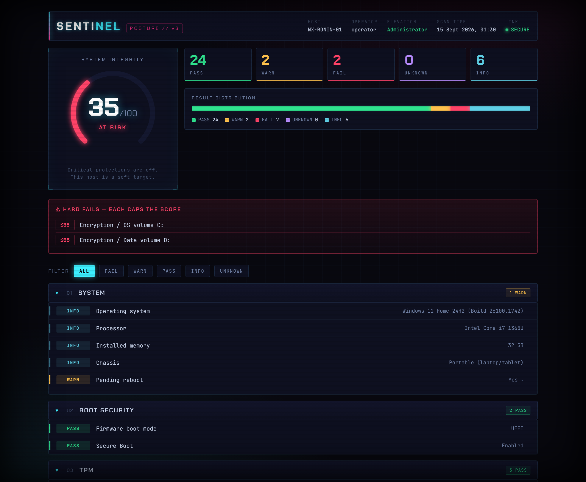

<div align="center">

```
 ____  _____ _   _ _____ ___ _   _ _____ _
/ ___|| ____| \ | |_   _|_ _| \ | | ____| |
\___ \|  _| |  \| | | |  | ||  \| |  _| | |
 ___) | |___| |\  | | |  | || |\  | |___| |___
|____/|_____|_| \_| |_| |___|_| \_|_____|_____|
```

### Windows Security Posture Audit

**A read-only Windows hardening audit. One score, one report, nothing changed.**

[](https://github.com/halonyx-io/sentinel/actions/workflows/tests.yml)


</div>

---

Sentinel checks the settings that decide how a Windows machine holds up if it's stolen or gets
malware: Secure Boot, TPM, BitLocker, VBS/HVCI, Credential Guard, LSA protection, Defender, the
firewall, SMB, RDP and UAC. It turns the results into a 0–100 score and a set of reports.

It doesn't change anything. No registry writes, no toggles, no fixes. It reads and reports.

It runs locally, or against another Windows box over WinRM or SSH, and it can diff two runs so
you can see what actually changed.

## What it looks like

[](examples/sentinel-report.example.html)

<sub>Each run writes a single self-contained HTML file like this. **[Open the example](examples/sentinel-report.example.html)** · [more on the dashboard](docs/SENTINEL.md)</sub>

And in the terminal:

```
  ==============================================================
  SYSTEM INTEGRITY  [###############---------------------------]  35/100  AT RISK
  Critical protections are off. This host is a soft target.

  HARD FAILS (each caps the score):
    x Encryption / OS volume C:  -> score capped at 35
    x Encryption / Data volume D:  -> score capped at 65

  PASS 24    WARN 2    FAIL 2    UNKNOWN 0    INFO 10
  ==============================================================
```

24 passes, and it still scores 35 because the drives aren't encrypted. That's deliberate: a pile
of green ticks shouldn't hide the one thing that matters.

## Quick start

Clone or download the repo, then from an elevated PowerShell prompt:

```powershell
.\WindowsSecurityAudit.ps1
```

If the execution policy blocks it, bypass it for this one run:

```powershell
powershell -ExecutionPolicy Bypass -File .\WindowsSecurityAudit.ps1
```

> **Run it as Administrator.** It works without admin, but BitLocker and some Defender/TPM detail
> can't be read, so those checks come back `UNKNOWN`, the run is marked **INCOMPLETE** and the
> score is held at 74 or below.

## What it checks

| Area | Checks |
|------|--------|
| **System** | Edition, build, model, CPU, RAM, BIOS/UEFI, pending reboot |
| **Boot & TPM** | Firmware mode, Secure Boot, TPM present / version / ready / locked out (presence and version work without admin) |
| **Storage** | Physical disk health, Storage Spaces pools and virtual disks, volume health, disk-to-volume mapping |
| **Encryption** | OS and data volume state, protection status, % encrypted, cipher strength (XTS-AES-256 vs weaker), key protector quality (TPM+PIN > TPM > password), recovery key, auto-unlock. Falls back from the BitLocker cmdlets to the Device Encryption WMI provider (so it works on Home), then to detecting third-party FDE |
| **Antivirus** | Whether *some* real-time AV is on and up to date, from Windows Security Center. Passive Defender behind a healthy third-party AV passes |
| **Virtualisation security** | VBS, Memory Integrity / HVCI, Credential Guard, Secure Launch, kernel-mode stack protection |
| **Credential protection** | LSA protection, read from the protection level LSASS is actually running with. Falls back to the WinInit boot event, then the `RunAsPPL` setting |
| **Defender** | Running mode, real-time and behaviour monitoring, download scanning, signature age, Tamper Protection |
| **Network** | Firewall profiles (each scored separately), SMBv1, SMB signing, guest logons, RDP + NLA |
| **Privilege** | UAC, admin elevation prompt, Secure Desktop |
| **Diagnostics** | Uptime, system drive free space, latest installed update. Shown for triage, not scored |

Storage is mapped disk → pool → virtual disk → volume → BitLocker, so pooled or spanned layouts
aren't mistaken for one disk per drive letter.

## Parameters

| Parameter | Effect |
|-----------|--------|
| `-OutputDirectory <path>` | Where reports go. Default: a `WindowsSecurityAudit` folder next to the script |
| `-OpenReport` | Open the HTML dashboard when the scan finishes |
| `-NoHtml` | Skip the dashboard (JSON, TXT and CSV are still written) |
| `-NoExport` | Console only, no files |
| `-Quiet` | No console report |
| `-PassThru` | Return the report object to the pipeline |

```powershell
$audit = .\WindowsSecurityAudit.ps1 -OpenReport -PassThru
$audit.Checks | Where-Object Status -eq 'FAIL'
```

## Audit another machine

`Invoke-SentinelRemote.ps1` runs the audit on a remote Windows host and gives you the report
locally. Over WinRM the script runs entirely in memory. Over SSH it's staged compressed in the
target's temp folder, run from there, and deleted when the audit finishes — nothing is installed
and nothing persists.

```powershell
# Domain-joined target, Kerberos over WinRM
$audit = ./Invoke-SentinelRemote.ps1 -ComputerName pc01.corp.example.com -HtmlPath ./pc01.html

# Workgroup target or IP address: WinRM over HTTPS with a certificate your client trusts
$audit = ./Invoke-SentinelRemote.ps1 -ComputerName 192.0.2.10 -UseSSL -Credential (Get-Credential)

# Windows OpenSSH (works from PowerShell on Linux too)
$audit = ./Invoke-SentinelRemote.ps1 -SshHost admin@pc01 -HtmlPath ./pc01.html
$audit.Checks | Where-Object Status -in FAIL, WARN, UNKNOWN
```

A few things to know:

- **WinRM** uses Kerberos, or HTTPS with full certificate validation. It won't fall back to
  plain-HTTP NTLM or skip certificate checks. On a workgroup machine that means setting up an
  HTTPS listener first.
- **SSH** uses your system OpenSSH client, your existing `known_hosts` entry and key-based auth.
  It never prompts and never accepts an unknown host key. It works against older and newer Windows
  OpenSSH builds alike — the source is sent in command-line-sized pieces rather than over stdin,
  which newer builds can deadlock on.
- The audit runs in Windows PowerShell 5.1 on the target. Connect with an admin account or the
  run will be INCOMPLETE.

## Compare two audits

```powershell
$diff = ./Compare-SentinelReport.ps1 -Before ./before.json -After ./after.json
$diff.Changes | Format-Table Category, Check, Change
```

Feed it two JSON reports from the same machine. Each check that moved is labelled `Improved`,
`Deteriorated`, `Added`, `Removed`, `EvidenceChanged` or `AssessmentChanged`. You only get a score
delta when the two runs are actually comparable: same report and scoring versions, same elevation,
coverage and completeness. Otherwise `ScoreComparable` is false and the delta is left empty
rather than misleading you.

## Output files

Written to the output directory, named by hostname and timestamp:

- **`.html`**: the [dashboard](docs/SENTINEL.md). One file, no external resources, works offline.
- **`.json`**: the full report, for scripts and for `Compare-SentinelReport`. Carries
  `SentinelVersion`, `ScoringVersion`, `Score`, `Posture`, `Verdict`, `Coverage`, `Incomplete`,
  `HardFails` and `NotEvaluated` next to every check, so the console, dashboard and any tooling
  all show the same verdict.
- **`.txt`**: a plain-text report.
- **`_checks.csv`**, plus CSVs for disks, pools, virtual disks, volumes, BitLocker and AV products.

## How the score works

It's not a count of passes. Twenty healthy disks shouldn't make up for Secure Boot being off.
Each real security control has a **weight**. The critical ones also have a **cap**: the highest
score the machine can get while that control is failing. Inventory and health checks carry no
weight at all.

```
outcome:  PASS 1.0   WARN 0.5   FAIL 0.0   UNKNOWN excluded
base   = 100 × Σ(weight × outcome) / Σ(weight of known controls)
score  = min(base, caps of failing or unknown critical controls, 74 if incomplete)
```

An unencrypted OS drive caps the machine at 35. An unencrypted fixed data drive caps it at 65.
Caps stack, and the lowest one wins. Encryption, Secure Boot, TPM, AV and the firewall carry most
of the weight, because theft and malware are what this is tuned for.

**Not knowing is not a pass.** A required control that returns nothing (a missing cmdlet, a
provider that threw, a drive no encryption provider will report) is listed as **NOT EVALUATED**
and counts against coverage. If it's a critical control it caps the score the same way a failure
would. Any unknown required control, a coverage below 80% or a non-elevated run marks the result
**INCOMPLETE**, which keeps it out of the two green bands.

| Score | Band | Meaning |
|-------|------|---------|
| 90–100 | **HARDENED** | Strong. What's left is polish. |
| 75–89 | **FORTIFIED** | Solid baseline, a few gaps. |
| 60–74 | **GUARDED** | Adequate, but core protections need work. |
| 40–59 | **EXPOSED** | Core protections missing. Start with the FAILs. |
| 20–39 | **AT RISK** | Critical protections off. |
| 0–19 | **CRITICAL** | The basics aren't there. |

The weights and caps are in the `$Map` table in `Get-PostureAssessment`, and the bands are in
`Get-PostureBand`. They're a judgement call, so change them if your machines need something different.

## Requirements and safety

- Windows 10 / 11 or recent Windows Server, with **Windows PowerShell 5.1** or **PowerShell 7+**.
- Remote audits: the target needs WinRM or Windows OpenSSH. The client needs PowerShell, plus the
  OpenSSH client for SSH mode.
- **Read-only.** The only thing it writes is the report files, into the output directory you choose.
- Reports describe a real machine's weak spots. Treat them as sensitive. `.gitignore` already keeps
  generated reports out of the repo.

## Tests

The failure that matters most here is a quiet one: a control stops counting, and an unprotected
machine reports as a safe one. The tests are aimed at that.

```powershell
.\tests\Test-Sentinel.ps1     # scoring model: caps, blind spots, dilution, LSA state
.\tests\Test-Compare.ps1      # report comparison
.\tests\Test-HtmlReport.ps1   # hostile strings can't break out of the dashboard
.\tests\Test-Collectors.ps1   # full audit on this machine, checks every export
```

They load the real functions out of the script rather than copies of them. CI runs all four on
Windows PowerShell 5.1 and PowerShell 7. Both remote modes have also been run against real
Windows 11 hardware. CI only syntax-checks them, because it has no remote host to connect to.

## Limitations

Read these before trusting a number:

- **It's not a malware scan, a pen test or a compliance audit.** A HARDENED machine can still be
  compromised. Sentinel reads configuration. It doesn't look for intruders.
- **Run it elevated or don't trust the score.** Non-admin runs are marked INCOMPLETE and capped
  for a reason.
- **Third-party disk encryption can't be verified.** Sentinel can tell VeraCrypt, ESET, Sophos and
  others are installed, but not whether they're protecting the drive. That shows as UNKNOWN. It
  would rather under-credit than over-credit you.
- **Dynamic or spanned volumes can't be BitLocker-encrypted**, and nothing reports on them. They
  show up as blind spots.
- **The AV verdict decodes Security Center's `productState`**, whose bit layout is
  community-documented rather than official. An unusual vendor could be misread.
- **Windows Server has no Security Center**, so the antivirus control is UNKNOWN there.
- **The weights are tuned for workstations and laptops.** A server or kiosk probably wants a
  different table.

If you find a case where Sentinel says a machine is safer than it really is, please open an issue.
That's the kind of bug this project cares about most.

## Changelog

See [CHANGELOG.md](CHANGELOG.md).

## License

MIT, see [LICENSE](LICENSE). Provided as-is, with no warranty.
