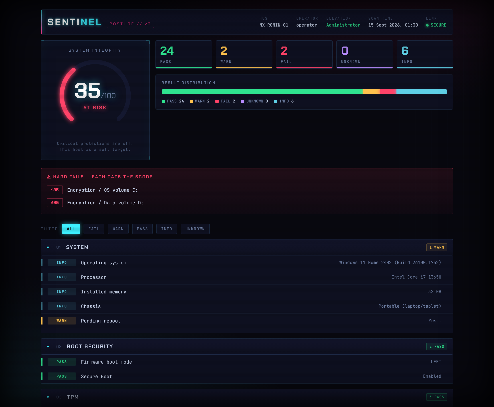

# SENTINEL — the HTML readout

> The dashboard Sentinel writes at the end of every scan. One self-contained `.html` file: a
> CRT-terminal security console with an integrity gauge, live filtering and drill-down findings.
> No server, no build step, no internet — it runs from a double-click.

**▶ See it now:** open [`examples/sentinel-report.example.html`](../examples/sentinel-report.example.html)
in a browser (sample data — a fictional host, safe to share).

<!--
  Drop a real screenshot at docs/dashboard.png and uncomment this to show it at the top:
  
-->

## Why it exists

The console report is great in a terminal. It's useless in an email, a ticket, or a "can you check
my mum's laptop" text. The HTML readout is the shareable artifact: hand someone one file and they
see the whole posture at a glance — score first, then the detail, colour-coded so what needs
attention reads instantly.

## What's in it

- **Integrity gauge** — the same 0–100 score as the console, as a sweeping neon ring, with the band
  (`HARDENED` → `COMPROMISED`) and a one-line verdict.
- **Status tiles** — PASS / WARN / FAIL / UNKNOWN / INFO counts. Click one to filter the whole page
  to just those results.
- **Distribution bar** — the mix of results at a glance.
- **Category panels** — every check, grouped, with a severity stripe and status pill. Click any
  `FAIL` / `WARN` (anything with detail) to expand the finding — including what was *expected*.
- **Filter bar** — ALL / FAIL / WARN / PASS / INFO / UNKNOWN.

Everything is keyboard-navigable, respects `prefers-reduced-motion`, and degrades to system fonts if
Google Fonts can't load (offline, air-gapped, locked-down network — still works).

## How the data gets in

There's no magic and no external data file. At export time the script serialises its report object
and injects it straight into the page:

```powershell
$Json     = $Report | ConvertTo-Json -Depth 12    # the whole audit
$Template = @' …the HTML/CSS/JS… '@                # embedded in the script
$html     = $Template.Replace('@@REPORT_JSON@@', $Json)
```

The page's JavaScript reads that one `REPORT` object and renders itself. The score is recomputed in
the browser from the same checks, so the gauge can never disagree with the numbers below it. See
[`examples/sentinel-report.template.html`](../examples/sentinel-report.template.html) for the exact
template (the `@@REPORT_JSON@@` placeholder is where your data lands).

## Design notes

Committed single-theme by choice — this is a neon terminal, not a document, so it stays dark on any
host:

| Token | Value | Role |
|-------|-------|------|
| ground | `#08080f` | the void |
| panel | `#0e1020` | surfaces |
| cyan | `#3df0ff` | primary accent / system hue |
| magenta | `#ff2e88` | secondary accent (the synthwave pairing) |
| pass / warn / fail | `#2fe38f` / `#ffc24d` / `#ff4368` | semantic channel, kept separate from the accent |

Type is **Chakra Petch** (squared, technical — the equipment-label face) for headings and labels,
**JetBrains Mono** for the data rows. Scanlines, vignette and the gauge sweep are the only motion,
and all of it is disabled under reduced-motion.

## Customising it

Everything lives in the `New-HtmlReport` here-string inside `WindowsSecurityAudit.ps1`:

- **Palette** — edit the CSS custom properties in `:root`.
- **Score bands / labels** — the `BANDS` array in the page's `<script>` (mirror any change to
  `Get-PostureBand` in the PowerShell so console and HTML stay in step).
- **Extra panels** — the `REPORT` object also carries `Storage` (physical disks, pools, virtual
  disks, volumes, BitLocker) and `AntivirusProducts`; they're exported but not yet drawn. Wiring a
  storage-map panel is a good first extension.

## Privacy

A generated report is a description of a real machine's security state — Secure Boot status, disk
serials, whether BitLocker is on. Treat it like any other host inventory. The repo's `.gitignore`
keeps real `WindowsSecurityAudit_*.html` files out of source control; only the sanitised sample in
`examples/` is meant to be shared.
